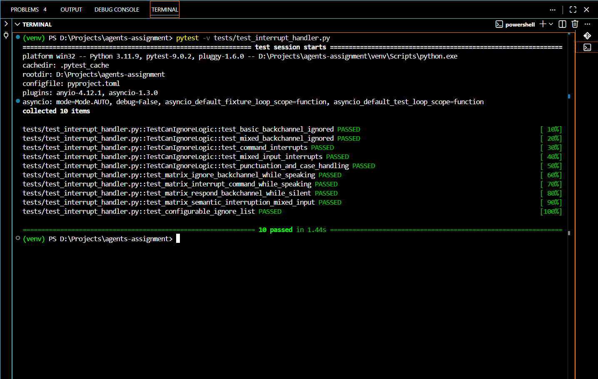

# LiveKit Intelligent Interruption Handling

This repository contains a refined conversational logic layer for a real-time AI agent. It implements a context-aware interruption handler that distinguishes between passive "backchanneling" (listener feedback) and active user interruptions, as required by the LiveKit Intelligent Interruption Handling Challenge.

### Submitted By
**Name:** Hari Kishoare
**GitHub Username:** atomiclifestyle
**Branch:** feature/interrupt-handler-hariKishore
**College:** International Institute of Information Technology(IIIT), Bhubaneswar
**ID:** B423024
**Date of Submission:** 26th January 2026

## Overview

The default Voice Activity Detection (VAD) in real-time agents can be overly sensitive, cutting off the agent when the user says simple filler words like "yeah" or "uh-huh".

This solution implements a logic filtering layer that adheres to the following behavioral matrix:

| User Input | Agent State | Behavior | Outcome |
|:-----------|:------------|:---------|:--------|
| "Yeah" / "Ok" / "Hmm" | Speaking | IGNORE | Agent continues speaking seamlessly. |
| "Stop" / "Wait" | Speaking | INTERRUPT | Agent stops immediately. |
| "Yeah" / "Ok" | Silent | RESPOND | Agent treats this as a conversational turn. |
| "Yeah but wait" | Speaking | INTERRUPT | Mixed input triggers a stop. |

## Features

* **Context Awareness:** Dynamically checks if the agent is "speaking" or "listening" before deciding to interrupt.
* **Configurable Ignore List:** The list of "soft" interruption words is customizable via environment variables and via session options.
* **Greedy Matching Strategy:** Accurately detects phrases (e.g., "make sense") and handles complex sentences to prevent false positives.
* **Latency Optimized:** Logic is injected directly into the audio activity loop to ensure real-time performance.
* **Test Coverage (pytest):** Comprehensive automated test suite written in pytest to validate interrupt logic, edge cases, and regression scenarios.

## Installation & Setup

### 1. Prerequisites
* Python 3.8+
* LiveKit API Credentials

### 2. Setup
Clone the repository and install dependencies:
```bash
# Install dependencies
pip install "livekit-agents[openai,silero,deepgram,cartesia,turn-detector]>=1.0"
pip install "python-dotenv" "opentelemetry-api>=1.34" "opentelemetry-sdk>=1.34.1" "opentelemetry-exporter-otlp>=1.34.1"

# Install the local package in editable mode (Critical for local dev)
pip install -e livekit-agents
```

### 3. Configuration
Create a `.env` file in the root directory. You must configure the standard LiveKit keys, and you can optionally override the ignore list.
```bash
# LiveKit Configuration
LIVEKIT_URL=wss://your-project.livekit.cloud
LIVEKIT_API_KEY=API...
LIVEKIT_API_SECRET=Secret...
OPENAI_API_KEY=sk-...

# Custom Ignore List (Optional)
INTERRUPT_IGNORE_WORDS=yes,yeah,yep,yup,sure,ok,okay
```

If `INTERRUPT_IGNORE_WORDS` is not set, the agent defaults to a standard list of backchannel phrases.
**Default Ignore List:**
```python
DEFAULT_IGNORE_LIST: list[str] = [
    "yes", "yeah", "yep", "yup", "sure", "ok", "okay", "alright", "all right", "right", "fine", "cool",
    "i see", "got it", "understood", "makes sense",
    "uh-huh", "mhmm", "hmm", "aha", "mm-hmm", "mhm",
    "go on", "keep going", "continue",
    "oh", "ohh", "ah", "wow", "k",
]
```
## Programmatic Configuration
You can also configure the ignore list directly while creating a agent using livekit by passing it to the session options. This takes precedence over default settings and allows for per-session customization.

```python
from livekit.agents import (AgentSession)

@server.rtc_session()
async def entrypoint(ctx: JobContext):
    # ... other fields ...
    
    session = AgentSession(
        # ... other configs ...
        ignore_list=["yeah", "ok", "absolutely", "continue"]
    )

```

## Logic Implementation

The core logic is implemented in `_interrupt_by_audio_activity`.

1. **State Check:** The handler first verifies if `self._session.agent_state == "speaking"`.
2. **Transcription Analysis:** If speaking, it captures the incoming user transcript.
3. **Filtering:** It runs `can_ignore(transcript, ignore_list)`:
   * It normalizes text (removes punctuation/case).
   * It checks if the entirety of the user's speech consists only of ignored words.
   * If True: The interruption signal is suppressed, and the agent continues.
   * If False (e.g., "Yeah stop"): The standard interruption sequence proceeds.

## Testing

### Automated Tests
Run the included pytest suite to verify the logic matrix:
```bash
pip install pytest pytest-asyncio

pytest -v tests/test_interrupt_handler.py
```

## Test Evidence

### Automated Test Results (Screenshot)



### Manual Test Video
[Watch Manual Verification Video](https://drive.google.com/file/d/1fcADRNEMX3eJtvRIdkjzw3zs8N0nIvVT/view?usp=sharing)


### Log Output
```text
    07:37:21 DEBUG  asyncio          Using selector: EpollSelector  
             DEV    livekit.agents   Watching /workspaces/agents-assignment/examples/voice_agents  
             DEV    livekit.agents   Watching /workspaces/agents-assignment/livekit-agents  
             DEV    livekit.agents   Watching /workspaces/agents-assignment/livekit-plugins/livekit-plugins-silero  
             DEV    livekit.agents   Watching /workspaces/agents-assignment/livekit-plugins/livekit-plugins-turn-detector  
    07:37:23 DEBUG  asyncio          Using selector: EpollSelector  
             INFO   livekit.agents   starting worker {"version": "1.3.3", "rtc-version": "1.0.19"}
             INFO   livekit.agents   preloading plugins {"packages": ["livekit.plugins.silero", "livekit.plugins.turn_detector", "av"]}
             INFO   livekit.agents   starting inference executor  
    07:37:24 INFO   livekit.agents   initializing process {"pid": 14146, "inference": true}
    07:37:26 INFO   livekit.agents   process initialized {"pid": 14146, "inference": true, "elapsed_time": 2.45}
    07:37:27 INFO   livekit.agents   registered worker {"agent_name": "", "id": "AW_duX62PuC4MWW", "url":                                      
                                                       "wss://testassignment-aaca19ol.livekit.cloud", "region": "India West", "protocol": 16}  
    07:38:22 INFO   livekit.agents   received job request {"job_id": "AJ_5Kb6HzKCgmLE", "dispatch_id": "AD_9Gs8RxLhukFA", "room":              
                                                          "sbx-2pt8bs-CAKFKEgkhYkCRkknUCSNPX", "room_id": "RM_Q9fmwZ8VaZdc", "agent_name": "", 
                                                          "resuming": false, "enable_recording": false}                                        
             DEBUG  livekit.agents   received assignment {"agent_name": "", "room_id": "RM_Q9fmwZ8VaZdc", "room":                              
                                                         "sbx-2pt8bs-CAKFKEgkhYkCRkknUCSNPX", "job_id": "AJ_5Kb6HzKCgmLE", "dispatch_id":      
                                                         "AD_9Gs8RxLhukFA", "enable_recording": false}                                         
             INFO   livekit.agents   initializing process {"pid": 14596}
             INFO   livekit.agents   process initialized {"pid": 14596, "elapsed_time": 0.08}
             DEBUG  asyncio          Using selector: EpollSelector {"pid": 14596, "job_id": "AJ_5Kb6HzKCgmLE", "room_id": "RM_Q9fmwZ8VaZdc"}
             DEBUG  livekit.agents   input stream attached {"room": "sbx-2pt8bs-CAKFKEgkhYkCRkknUCSNPX", "participant": null, "source":        
                                                           "SOURCE_UNKNOWN", "accepted_sources": ["SOURCE_MICROPHONE"], "pid": 14596, "job_id":
                                                           "AJ_5Kb6HzKCgmLE", "room_id": "RM_Q9fmwZ8VaZdc"}                                    
             DEBUG  livekit.agents   http_session(): creating a new httpclient ctx {"room": "sbx-2pt8bs-CAKFKEgkhYkCRkknUCSNPX", "pid": 14596, 
                                                                                   "job_id": "AJ_5Kb6HzKCgmLE", "room_id": "RM_Q9fmwZ8VaZdc"}  
    07:38:23 INFO   livekit.agents   LLM metrics {"room": "sbx-2pt8bs-CAKFKEgkhYkCRkknUCSNPX", "model_name": "openai/gpt-4.1-mini",            
                                                 "model_provider": "livekit", "ttft": 0.85, "prompt_tokens": 185, "prompt_cached_tokens": 0,   
                                                 "completion_tokens": 18, "tokens_per_second": 17.68, "pid": 14596, "job_id":                  
                                                 "AJ_5Kb6HzKCgmLE", "room_id": "RM_Q9fmwZ8VaZdc"}                                              
    07:38:24 DEBUG  livekit.agents   using audio io: `RoomIO` -> `AgentSession` ->        {"room": "sbx-2pt8bs-CAKFKEgkhYkCRkknUCSNPX", "pid": 
                                     `TranscriptSynchronizer` -> `RoomIO`                 14596, "job_id": "AJ_5Kb6HzKCgmLE", "room_id":       
                                                                                          "RM_Q9fmwZ8VaZdc"}                                   
             DEBUG  livekit.agents   using transcript io: `AgentSession` ->               {"room": "sbx-2pt8bs-CAKFKEgkhYkCRkknUCSNPX", "pid": 
                                     `TranscriptSynchronizer` -> `RoomIO`                 14596, "job_id": "AJ_5Kb6HzKCgmLE", "room_id":       
                                                                                          "RM_Q9fmwZ8VaZdc"}                                   
             INFO   livekit.agents   TTS metrics {"room": "sbx-2pt8bs-CAKFKEgkhYkCRkknUCSNPX", "model_name": "cartesia/sonic-2",               
                                                 "model_provider": "livekit", "ttfb": 0.18825994100006938, "audio_duration": 3.85, "pid":      
                                                 14596, "job_id": "AJ_5Kb6HzKCgmLE", "room_id": "RM_Q9fmwZ8VaZdc"}                             
    07:38:25 DEBUG  livekit.agents   start reading stream {"room": "sbx-2pt8bs-CAKFKEgkhYkCRkknUCSNPX", "participant": "reactive-wireframe",   
                                                          "source": "SOURCE_MICROPHONE", "pid": 14596, "job_id": "AJ_5Kb6HzKCgmLE", "room_id": 
                                                          "RM_Q9fmwZ8VaZdc"}                                                                   
    07:38:27 INFO   livekit.agents   STT metrics {"room": "sbx-2pt8bs-CAKFKEgkhYkCRkknUCSNPX", "model_name": "deepgram/nova-3",                
                                                 "model_provider": "livekit", "audio_duration": 2.6, "pid": 14596, "job_id": "AJ_5Kb6HzKCgmLE",
                                                 "room_id": "RM_Q9fmwZ8VaZdc"}                                                                 
    07:38:32 INFO   livekit.agents   STT metrics {"room": "sbx-2pt8bs-CAKFKEgkhYkCRkknUCSNPX", "model_name": "deepgram/nova-3",                
                                                 "model_provider": "livekit", "audio_duration": 4.95, "pid": 14596, "job_id":                  
                                                 "AJ_5Kb6HzKCgmLE", "room_id": "RM_Q9fmwZ8VaZdc"}                                              
    07:38:35 INFO   livekit.agents   STT metrics {"room": "sbx-2pt8bs-CAKFKEgkhYkCRkknUCSNPX", "model_name": "deepgram/nova-3",                
                                                 "model_provider": "livekit", "audio_duration": 2.3, "pid": 14596, "job_id": "AJ_5Kb6HzKCgmLE",
                                                 "room_id": "RM_Q9fmwZ8VaZdc"}                                                                 
             DEBUG  livekit.agents   received user transcript {"room": "sbx-2pt8bs-CAKFKEgkhYkCRkknUCSNPX", "user_transcript": "Tell me a long 
                                                              story.", "language": "en", "transcript_delay": 0.5689699649810791, "pid": 14596, 
                                                              "job_id": "AJ_5Kb6HzKCgmLE", "room_id": "RM_Q9fmwZ8VaZdc"}                       
             DEBUG  livekit.plugins… eou prediction {"room": "sbx-2pt8bs-CAKFKEgkhYkCRkknUCSNPX", "eou_probability": 0.04410410299897194,      
                                                    "duration": 0.114, "input": "<|im_start|>assistant\nhey there ready to chat or need some   
                                                    info what's on your mind today<|im_end|>\n<|im_start|>user\ntell me a long story", "pid":  
                                                    14596, "job_id": "AJ_5Kb6HzKCgmLE", "room_id": "RM_Q9fmwZ8VaZdc"}                          
             DEBUG  livekit.agents   using preemptive generation {"room": "sbx-2pt8bs-CAKFKEgkhYkCRkknUCSNPX", "preemptive_lead_time":         
                                                                 0.11973404884338379, "pid": 14596, "job_id": "AJ_5Kb6HzKCgmLE", "room_id":    
                                                                 "RM_Q9fmwZ8VaZdc"}                                                            
             INFO   livekit.agents   EOU metrics {"room": "sbx-2pt8bs-CAKFKEgkhYkCRkknUCSNPX", "model_name": "multilingual", "model_provider": 
                                                 "livekit", "end_of_utterance_delay": 0.69, "transcription_delay": 0.57, "pid": 14596,         
                                                 "job_id": "AJ_5Kb6HzKCgmLE", "room_id": "RM_Q9fmwZ8VaZdc"}                                    
    07:38:40 INFO   livekit.agents   STT metrics {"room": "sbx-2pt8bs-CAKFKEgkhYkCRkknUCSNPX", "model_name": "deepgram/nova-3",                
                                                 "model_provider": "livekit", "audio_duration": 4.95, "pid": 14596, "job_id":                  
                                                 "AJ_5Kb6HzKCgmLE", "room_id": "RM_Q9fmwZ8VaZdc"}                                              
             INFO   livekit.agents   LLM metrics {"room": "sbx-2pt8bs-CAKFKEgkhYkCRkknUCSNPX", "model_name": "openai/gpt-4.1-mini",            
                                                 "model_provider": "livekit", "ttft": 0.72, "prompt_tokens": 216, "prompt_cached_tokens": 0,   
                                                 "completion_tokens": 297, "tokens_per_second": 50.78, "pid": 14596, "job_id":                 
                                                 "AJ_5Kb6HzKCgmLE", "room_id": "RM_Q9fmwZ8VaZdc"}                                              
    07:38:43 INFO   livekit.agents   STT metrics {"room": "sbx-2pt8bs-CAKFKEgkhYkCRkknUCSNPX", "model_name": "deepgram/nova-3",                
                                                 "model_provider": "livekit", "audio_duration": 3.05, "pid": 14596, "job_id":                  
                                                 "AJ_5Kb6HzKCgmLE", "room_id": "RM_Q9fmwZ8VaZdc"}                                              
    07:38:46 INFO   livekit.agents   STT metrics {"room": "sbx-2pt8bs-CAKFKEgkhYkCRkknUCSNPX", "model_name": "deepgram/nova-3",                
                                                 "model_provider": "livekit", "audio_duration": 3.7, "pid": 14596, "job_id": "AJ_5Kb6HzKCgmLE",
                                                 "room_id": "RM_Q9fmwZ8VaZdc"}                                                                 
    07:38:47 INFO   livekit.agents   LOGGER: '' is a backchannel, Agent not interrupted {"room": "sbx-2pt8bs-CAKFKEgkhYkCRkknUCSNPX", "pid":   
                                                                                        14596, "job_id": "AJ_5Kb6HzKCgmLE", "room_id":         
                                                                                        "RM_Q9fmwZ8VaZdc"}                                     
             INFO   livekit.agents   LOGGER: '' is a backchannel, Agent not interrupted {"room": "sbx-2pt8bs-CAKFKEgkhYkCRkknUCSNPX", "pid":   
                                                                                        14596, "job_id": "AJ_5Kb6HzKCgmLE", "room_id":         
                                                                                        "RM_Q9fmwZ8VaZdc"}                                     
             INFO   livekit.agents   LOGGER: '' is a backchannel, Agent not interrupted {"room": "sbx-2pt8bs-CAKFKEgkhYkCRkknUCSNPX", "pid":   
                                                                                        14596, "job_id": "AJ_5Kb6HzKCgmLE", "room_id":         
                                                                                        "RM_Q9fmwZ8VaZdc"}                                     
             INFO   livekit.agents   LOGGER: '' is a backchannel, Agent not interrupted {"room": "sbx-2pt8bs-CAKFKEgkhYkCRkknUCSNPX", "pid":   
                                                                                        14596, "job_id": "AJ_5Kb6HzKCgmLE", "room_id":         
                                                                                        "RM_Q9fmwZ8VaZdc"}                                     
             INFO   livekit.agents   LOGGER: '' is a backchannel, Agent not interrupted {"room": "sbx-2pt8bs-CAKFKEgkhYkCRkknUCSNPX", "pid":   
                                                                                        14596, "job_id": "AJ_5Kb6HzKCgmLE", "room_id":         
                                                                                        "RM_Q9fmwZ8VaZdc"}                                     
             INFO   livekit.agents   LOGGER: '' is a backchannel, Agent not interrupted {"room": "sbx-2pt8bs-CAKFKEgkhYkCRkknUCSNPX", "pid":   
                                                                                        14596, "job_id": "AJ_5Kb6HzKCgmLE", "room_id":         
                                                                                        "RM_Q9fmwZ8VaZdc"}                                     
             INFO   livekit.agents   LOGGER: '' is a backchannel, Agent not interrupted {"room": "sbx-2pt8bs-CAKFKEgkhYkCRkknUCSNPX", "pid":   
                                                                                        14596, "job_id": "AJ_5Kb6HzKCgmLE", "room_id":         
                                                                                        "RM_Q9fmwZ8VaZdc"}                                     
             INFO   livekit.agents   LOGGER: '' is a backchannel, Agent not interrupted {"room": "sbx-2pt8bs-CAKFKEgkhYkCRkknUCSNPX", "pid":   
                                                                                        14596, "job_id": "AJ_5Kb6HzKCgmLE", "room_id":         
                                                                                        "RM_Q9fmwZ8VaZdc"}                                     
             INFO   livekit.agents   LOGGER: '' is a backchannel, Agent not interrupted {"room": "sbx-2pt8bs-CAKFKEgkhYkCRkknUCSNPX", "pid":   
                                                                                        14596, "job_id": "AJ_5Kb6HzKCgmLE", "room_id":         
                                                                                        "RM_Q9fmwZ8VaZdc"}                                     
             INFO   livekit.agents   LOGGER: '' is a backchannel, Agent not interrupted {"room": "sbx-2pt8bs-CAKFKEgkhYkCRkknUCSNPX", "pid":   
                                                                                        14596, "job_id": "AJ_5Kb6HzKCgmLE", "room_id":         
                                                                                        "RM_Q9fmwZ8VaZdc"}                                     
             INFO   livekit.agents   LOGGER: '' is a backchannel, Agent not interrupted {"room": "sbx-2pt8bs-CAKFKEgkhYkCRkknUCSNPX", "pid":   
                                                                                        14596, "job_id": "AJ_5Kb6HzKCgmLE", "room_id":         
                                                                                        "RM_Q9fmwZ8VaZdc"}                                     
             INFO   livekit.agents   LOGGER: '' is a backchannel, Agent not interrupted {"room": "sbx-2pt8bs-CAKFKEgkhYkCRkknUCSNPX", "pid":   
                                                                                        14596, "job_id": "AJ_5Kb6HzKCgmLE", "room_id":         
                                                                                        "RM_Q9fmwZ8VaZdc"}                                     
             INFO   livekit.agents   LOGGER: '' is a backchannel, Agent not interrupted {"room": "sbx-2pt8bs-CAKFKEgkhYkCRkknUCSNPX", "pid":   
                                                                                        14596, "job_id": "AJ_5Kb6HzKCgmLE", "room_id":         
                                                                                        "RM_Q9fmwZ8VaZdc"}                                     
    07:38:48 INFO   livekit.agents   LOGGER: '' is a backchannel, Agent not interrupted {"room": "sbx-2pt8bs-CAKFKEgkhYkCRkknUCSNPX", "pid":   
                                                                                        14596, "job_id": "AJ_5Kb6HzKCgmLE", "room_id":         
                                                                                        "RM_Q9fmwZ8VaZdc"}                                     
             INFO   livekit.agents   LOGGER: '' is a backchannel, Agent not interrupted {"room": "sbx-2pt8bs-CAKFKEgkhYkCRkknUCSNPX", "pid":   
                                                                                        14596, "job_id": "AJ_5Kb6HzKCgmLE", "room_id":         
                                                                                        "RM_Q9fmwZ8VaZdc"}                                     
             INFO   livekit.agents   LOGGER: '' is a backchannel, Agent not interrupted {"room": "sbx-2pt8bs-CAKFKEgkhYkCRkknUCSNPX", "pid":   
                                                                                        14596, "job_id": "AJ_5Kb6HzKCgmLE", "room_id":         
                                                                                        "RM_Q9fmwZ8VaZdc"}                                     
             INFO   livekit.agents   LOGGER: '' is a backchannel, Agent not interrupted {"room": "sbx-2pt8bs-CAKFKEgkhYkCRkknUCSNPX", "pid":   
                                                                                        14596, "job_id": "AJ_5Kb6HzKCgmLE", "room_id":         
                                                                                        "RM_Q9fmwZ8VaZdc"}                                     
             INFO   livekit.agents   STT metrics {"room": "sbx-2pt8bs-CAKFKEgkhYkCRkknUCSNPX", "model_name": "deepgram/nova-3",                
                                                 "model_provider": "livekit", "audio_duration": 1.35, "pid": 14596, "job_id":                  
                                                 "AJ_5Kb6HzKCgmLE", "room_id": "RM_Q9fmwZ8VaZdc"}                                              
             INFO   livekit.agents   LOGGER: '' is a backchannel, Agent not interrupted {"room": "sbx-2pt8bs-CAKFKEgkhYkCRkknUCSNPX", "pid":   
                                                                                        14596, "job_id": "AJ_5Kb6HzKCgmLE", "room_id":         
                                                                                        "RM_Q9fmwZ8VaZdc"}                                     
             DEBUG  livekit.agents   received user transcript {"room": "sbx-2pt8bs-CAKFKEgkhYkCRkknUCSNPX", "user_transcript": "Okay.",        
                                                              "language": "en", "transcript_delay": 0.5689780712127686, "pid": 14596, "job_id":
                                                              "AJ_5Kb6HzKCgmLE", "room_id": "RM_Q9fmwZ8VaZdc"}                                 
             DEBUG  livekit.plugins… eou prediction {"room": "sbx-2pt8bs-CAKFKEgkhYkCRkknUCSNPX", "eou_probability": 0.11288490146398544,      
                                                    "duration": 0.117, "input": "<|im_start|>assistant\nhey there ready to chat or need some   
                                                    info what's on your mind today<|im_end|>\n<|im_start|>user\ntell me a long story okay",    
                                                    "pid": 14596, "job_id": "AJ_5Kb6HzKCgmLE", "room_id": "RM_Q9fmwZ8VaZdc"}                   
    07:38:49 INFO   livekit.agents   STT metrics {"room": "sbx-2pt8bs-CAKFKEgkhYkCRkknUCSNPX", "model_name": "deepgram/nova-3",                
                                                 "model_provider": "livekit", "audio_duration": 1.65, "pid": 14596, "job_id":                  
                                                 "AJ_5Kb6HzKCgmLE", "room_id": "RM_Q9fmwZ8VaZdc"}                                              
    07:38:53 INFO   livekit.agents   STT metrics {"room": "sbx-2pt8bs-CAKFKEgkhYkCRkknUCSNPX", "model_name": "deepgram/nova-3",                
                                                 "model_provider": "livekit", "audio_duration": 3.5, "pid": 14596, "job_id": "AJ_5Kb6HzKCgmLE",
                                                 "room_id": "RM_Q9fmwZ8VaZdc"}                                                                 
             INFO   livekit.agents   LOGGER: 'Okay.' is a backchannel, Agent not          {"room": "sbx-2pt8bs-CAKFKEgkhYkCRkknUCSNPX", "pid": 
                                     interrupted                                          14596, "job_id": "AJ_5Kb6HzKCgmLE", "room_id":       
                                                                                          "RM_Q9fmwZ8VaZdc"}                                   
             INFO   livekit.agents   LOGGER: 'Okay.' is a backchannel, Agent not          {"room": "sbx-2pt8bs-CAKFKEgkhYkCRkknUCSNPX", "pid": 
                                     interrupted                                          14596, "job_id": "AJ_5Kb6HzKCgmLE", "room_id":       
                                                                                          "RM_Q9fmwZ8VaZdc"}                                   
             INFO   livekit.agents   LOGGER: 'Okay.' is a backchannel, Agent not          {"room": "sbx-2pt8bs-CAKFKEgkhYkCRkknUCSNPX", "pid": 
                                     interrupted                                          14596, "job_id": "AJ_5Kb6HzKCgmLE", "room_id":       
                                                                                          "RM_Q9fmwZ8VaZdc"}                                   
             INFO   livekit.agents   LOGGER: 'Okay.' is a backchannel, Agent not          {"room": "sbx-2pt8bs-CAKFKEgkhYkCRkknUCSNPX", "pid": 
                                     interrupted                                          14596, "job_id": "AJ_5Kb6HzKCgmLE", "room_id":       
                                                                                          "RM_Q9fmwZ8VaZdc"}                                   
             INFO   livekit.agents   LOGGER: 'Okay.' is a backchannel, Agent not          {"room": "sbx-2pt8bs-CAKFKEgkhYkCRkknUCSNPX", "pid": 
                                     interrupted                                          14596, "job_id": "AJ_5Kb6HzKCgmLE", "room_id":       
                                                                                          "RM_Q9fmwZ8VaZdc"}                                   
             INFO   livekit.agents   LOGGER: 'Okay.' is a backchannel, Agent not          {"room": "sbx-2pt8bs-CAKFKEgkhYkCRkknUCSNPX", "pid": 
                                     interrupted                                          14596, "job_id": "AJ_5Kb6HzKCgmLE", "room_id":       
                                                                                          "RM_Q9fmwZ8VaZdc"}                                   
             INFO   livekit.agents   LOGGER: 'Okay.' is a backchannel, Agent not          {"room": "sbx-2pt8bs-CAKFKEgkhYkCRkknUCSNPX", "pid": 
                                     interrupted                                          14596, "job_id": "AJ_5Kb6HzKCgmLE", "room_id":       
                                                                                          "RM_Q9fmwZ8VaZdc"}                                   
             INFO   livekit.agents   LOGGER: 'Okay.' is a backchannel, Agent not          {"room": "sbx-2pt8bs-CAKFKEgkhYkCRkknUCSNPX", "pid": 
                                     interrupted                                          14596, "job_id": "AJ_5Kb6HzKCgmLE", "room_id":       
                                                                                          "RM_Q9fmwZ8VaZdc"}                                   
             INFO   livekit.agents   LOGGER: 'Okay.' is a backchannel, Agent not          {"room": "sbx-2pt8bs-CAKFKEgkhYkCRkknUCSNPX", "pid": 
                                     interrupted                                          14596, "job_id": "AJ_5Kb6HzKCgmLE", "room_id":       
                                                                                          "RM_Q9fmwZ8VaZdc"}                                   
             INFO   livekit.agents   LOGGER: 'Okay.' is a backchannel, Agent not          {"room": "sbx-2pt8bs-CAKFKEgkhYkCRkknUCSNPX", "pid": 
                                     interrupted                                          14596, "job_id": "AJ_5Kb6HzKCgmLE", "room_id":       
                                                                                          "RM_Q9fmwZ8VaZdc"}                                   
             INFO   livekit.agents   LOGGER: 'Okay.' is a backchannel, Agent not          {"room": "sbx-2pt8bs-CAKFKEgkhYkCRkknUCSNPX", "pid": 
                                     interrupted                                          14596, "job_id": "AJ_5Kb6HzKCgmLE", "room_id":       
                                                                                          "RM_Q9fmwZ8VaZdc"}                                   
    07:38:54 DEBUG  livekit.plugins… eou prediction {"room": "sbx-2pt8bs-CAKFKEgkhYkCRkknUCSNPX", "eou_probability": 0.11288490146398544,      
                                                    "duration": 0.11, "input": "<|im_start|>assistant\nhey there ready to chat or need some    
                                                    info what's on your mind today<|im_end|>\n<|im_start|>user\ntell me a long story okay",    
                                                    "pid": 14596, "job_id": "AJ_5Kb6HzKCgmLE", "room_id": "RM_Q9fmwZ8VaZdc"}                   
             INFO   livekit.agents   STT metrics {"room": "sbx-2pt8bs-CAKFKEgkhYkCRkknUCSNPX", "model_name": "deepgram/nova-3",                
                                                 "model_provider": "livekit", "audio_duration": 0.95, "pid": 14596, "job_id":                  
                                                 "AJ_5Kb6HzKCgmLE", "room_id": "RM_Q9fmwZ8VaZdc"}                                              
    07:38:59 INFO   livekit.agents   STT metrics {"room": "sbx-2pt8bs-CAKFKEgkhYkCRkknUCSNPX", "model_name": "deepgram/nova-3",                
                                                 "model_provider": "livekit", "audio_duration": 5.0, "pid": 14596, "job_id": "AJ_5Kb6HzKCgmLE",
                                                 "room_id": "RM_Q9fmwZ8VaZdc"}                                                                 
    07:39:01 INFO   livekit.agents   TTS metrics {"room": "sbx-2pt8bs-CAKFKEgkhYkCRkknUCSNPX", "model_name": "cartesia/sonic-2",               
                                                 "model_provider": "livekit", "ttfb": 0.19738785600020492, "audio_duration": 82.15, "pid":     
                                                 14596, "job_id": "AJ_5Kb6HzKCgmLE", "room_id": "RM_Q9fmwZ8VaZdc"}                             
             INFO   livekit.agents   STT metrics {"room": "sbx-2pt8bs-CAKFKEgkhYkCRkknUCSNPX", "model_name": "deepgram/nova-3",                
                                                 "model_provider": "livekit", "audio_duration": 2.55, "pid": 14596, "job_id":                  
                                                 "AJ_5Kb6HzKCgmLE", "room_id": "RM_Q9fmwZ8VaZdc"}                                              
    07:39:03 INFO   livekit.agents   LOGGER: 'Okay.' is a backchannel, Agent not          {"room": "sbx-2pt8bs-CAKFKEgkhYkCRkknUCSNPX", "pid": 
                                     interrupted                                          14596, "job_id": "AJ_5Kb6HzKCgmLE", "room_id":       
                                                                                          "RM_Q9fmwZ8VaZdc"}                                   
             INFO   livekit.agents   LOGGER: 'Okay.' is a backchannel, Agent not          {"room": "sbx-2pt8bs-CAKFKEgkhYkCRkknUCSNPX", "pid": 
                                     interrupted                                          14596, "job_id": "AJ_5Kb6HzKCgmLE", "room_id":       
                                                                                          "RM_Q9fmwZ8VaZdc"}                                   
             INFO   livekit.agents   LOGGER: 'Okay.' is a backchannel, Agent not          {"room": "sbx-2pt8bs-CAKFKEgkhYkCRkknUCSNPX", "pid": 
                                     interrupted                                          14596, "job_id": "AJ_5Kb6HzKCgmLE", "room_id":       
                                                                                          "RM_Q9fmwZ8VaZdc"}                                   
             INFO   livekit.agents   LOGGER: 'Okay.' is a backchannel, Agent not          {"room": "sbx-2pt8bs-CAKFKEgkhYkCRkknUCSNPX", "pid": 
                                     interrupted                                          14596, "job_id": "AJ_5Kb6HzKCgmLE", "room_id":       
                                                                                          "RM_Q9fmwZ8VaZdc"}                                   
             INFO   livekit.agents   LOGGER: 'Okay.' is a backchannel, Agent not          {"room": "sbx-2pt8bs-CAKFKEgkhYkCRkknUCSNPX", "pid": 
                                     interrupted                                          14596, "job_id": "AJ_5Kb6HzKCgmLE", "room_id":       
                                                                                          "RM_Q9fmwZ8VaZdc"}                                   
             INFO   livekit.agents   LOGGER: 'Okay.' is a backchannel, Agent not          {"room": "sbx-2pt8bs-CAKFKEgkhYkCRkknUCSNPX", "pid": 
                                     interrupted                                          14596, "job_id": "AJ_5Kb6HzKCgmLE", "room_id":       
                                                                                          "RM_Q9fmwZ8VaZdc"}                                   
             INFO   livekit.agents   LOGGER: 'Okay.' is a backchannel, Agent not          {"room": "sbx-2pt8bs-CAKFKEgkhYkCRkknUCSNPX", "pid": 
                                     interrupted                                          14596, "job_id": "AJ_5Kb6HzKCgmLE", "room_id":       
                                                                                          "RM_Q9fmwZ8VaZdc"}                                   
             INFO   livekit.agents   LOGGER: 'Okay.' is a backchannel, Agent not          {"room": "sbx-2pt8bs-CAKFKEgkhYkCRkknUCSNPX", "pid": 
                                     interrupted                                          14596, "job_id": "AJ_5Kb6HzKCgmLE", "room_id":       
                                                                                          "RM_Q9fmwZ8VaZdc"}                                   
             INFO   livekit.agents   LOGGER: 'Okay.' is a backchannel, Agent not          {"room": "sbx-2pt8bs-CAKFKEgkhYkCRkknUCSNPX", "pid": 
                                     interrupted                                          14596, "job_id": "AJ_5Kb6HzKCgmLE", "room_id":       
                                                                                          "RM_Q9fmwZ8VaZdc"}                                   
             INFO   livekit.agents   LOGGER: 'Okay.' is a backchannel, Agent not          {"room": "sbx-2pt8bs-CAKFKEgkhYkCRkknUCSNPX", "pid": 
                                     interrupted                                          14596, "job_id": "AJ_5Kb6HzKCgmLE", "room_id":       
                                                                                          "RM_Q9fmwZ8VaZdc"}                                   
             INFO   livekit.agents   LOGGER: 'Okay.' is a backchannel, Agent not          {"room": "sbx-2pt8bs-CAKFKEgkhYkCRkknUCSNPX", "pid": 
                                     interrupted                                          14596, "job_id": "AJ_5Kb6HzKCgmLE", "room_id":       
                                                                                          "RM_Q9fmwZ8VaZdc"}                                   
             INFO   livekit.agents   LOGGER: 'Okay.' is a backchannel, Agent not          {"room": "sbx-2pt8bs-CAKFKEgkhYkCRkknUCSNPX", "pid": 
                                     interrupted                                          14596, "job_id": "AJ_5Kb6HzKCgmLE", "room_id":       
                                                                                          "RM_Q9fmwZ8VaZdc"}                                   
             INFO   livekit.agents   LOGGER: 'Okay.' is a backchannel, Agent not          {"room": "sbx-2pt8bs-CAKFKEgkhYkCRkknUCSNPX", "pid": 
                                     interrupted                                          14596, "job_id": "AJ_5Kb6HzKCgmLE", "room_id":       
                                                                                          "RM_Q9fmwZ8VaZdc"}                                   
             INFO   livekit.agents   LOGGER: 'Okay.' is a backchannel, Agent not          {"room": "sbx-2pt8bs-CAKFKEgkhYkCRkknUCSNPX", "pid": 
                                     interrupted                                          14596, "job_id": "AJ_5Kb6HzKCgmLE", "room_id":       
                                                                                          "RM_Q9fmwZ8VaZdc"}                                   
             INFO   livekit.agents   LOGGER: 'Okay. Fine.' is a backchannel, Agent not    {"room": "sbx-2pt8bs-CAKFKEgkhYkCRkknUCSNPX", "pid": 
                                     interrupted                                          14596, "job_id": "AJ_5Kb6HzKCgmLE", "room_id":       
                                                                                          "RM_Q9fmwZ8VaZdc"}                                   
             INFO   livekit.agents   LOGGER: 'Okay. Fine.' is a backchannel, Agent not    {"room": "sbx-2pt8bs-CAKFKEgkhYkCRkknUCSNPX", "pid": 
                                     interrupted                                          14596, "job_id": "AJ_5Kb6HzKCgmLE", "room_id":       
                                                                                          "RM_Q9fmwZ8VaZdc"}                                   
    07:39:04 DEBUG  livekit.plugins… eou prediction {"room": "sbx-2pt8bs-CAKFKEgkhYkCRkknUCSNPX", "eou_probability": 0.11288490146398544,      
                                                    "duration": 0.103, "input": "<|im_start|>assistant\nhey there ready to chat or need some   
                                                    info what's on your mind today<|im_end|>\n<|im_start|>user\ntell me a long story okay",    
                                                    "pid": 14596, "job_id": "AJ_5Kb6HzKCgmLE", "room_id": "RM_Q9fmwZ8VaZdc"}                   
             INFO   livekit.agents   STT metrics {"room": "sbx-2pt8bs-CAKFKEgkhYkCRkknUCSNPX", "model_name": "deepgram/nova-3",                
                                                 "model_provider": "livekit", "audio_duration": 2.4, "pid": 14596, "job_id": "AJ_5Kb6HzKCgmLE",
                                                 "room_id": "RM_Q9fmwZ8VaZdc"}                                                                 
             INFO   livekit.agents   LOGGER: 'Okay. Fine.' is a backchannel, Agent not    {"room": "sbx-2pt8bs-CAKFKEgkhYkCRkknUCSNPX", "pid": 
                                     interrupted                                          14596, "job_id": "AJ_5Kb6HzKCgmLE", "room_id":       
                                                                                          "RM_Q9fmwZ8VaZdc"}                                   
             DEBUG  livekit.agents   received user transcript {"room": "sbx-2pt8bs-CAKFKEgkhYkCRkknUCSNPX", "user_transcript": "Fine.",        
                                                              "language": "en", "transcript_delay": 0.868732213973999, "pid": 14596, "job_id": 
                                                              "AJ_5Kb6HzKCgmLE", "room_id": "RM_Q9fmwZ8VaZdc"}                                 
             DEBUG  livekit.plugins… eou prediction {"room": "sbx-2pt8bs-CAKFKEgkhYkCRkknUCSNPX", "eou_probability": 0.08851706236600876,      
                                                    "duration": 0.116, "input": "<|im_start|>assistant\nhey there ready to chat or need some   
                                                    info what's on your mind today<|im_end|>\n<|im_start|>user\ntell me a long story okay      
                                                    fine", "pid": 14596, "job_id": "AJ_5Kb6HzKCgmLE", "room_id": "RM_Q9fmwZ8VaZdc"}            
    07:39:09 INFO   livekit.agents   STT metrics {"room": "sbx-2pt8bs-CAKFKEgkhYkCRkknUCSNPX", "model_name": "deepgram/nova-3",                
                                                 "model_provider": "livekit", "audio_duration": 5.0, "pid": 14596, "job_id": "AJ_5Kb6HzKCgmLE",
                                                 "room_id": "RM_Q9fmwZ8VaZdc"}                                                                 
             INFO   livekit.agents   LOGGER: 'Okay. Fine.' is a backchannel, Agent not    {"room": "sbx-2pt8bs-CAKFKEgkhYkCRkknUCSNPX", "pid": 
                                     interrupted                                          14596, "job_id": "AJ_5Kb6HzKCgmLE", "room_id":       
                                                                                          "RM_Q9fmwZ8VaZdc"}                                   
             INFO   livekit.agents   LOGGER: 'Okay. Fine.' is a backchannel, Agent not    {"room": "sbx-2pt8bs-CAKFKEgkhYkCRkknUCSNPX", "pid": 
                                     interrupted                                          14596, "job_id": "AJ_5Kb6HzKCgmLE", "room_id":       
                                                                                          "RM_Q9fmwZ8VaZdc"}                                   
             INFO   livekit.agents   LOGGER: 'Okay. Fine.' is a backchannel, Agent not    {"room": "sbx-2pt8bs-CAKFKEgkhYkCRkknUCSNPX", "pid": 
                                     interrupted                                          14596, "job_id": "AJ_5Kb6HzKCgmLE", "room_id":       
                                                                                          "RM_Q9fmwZ8VaZdc"}                                   
             INFO   livekit.agents   LOGGER: 'Okay. Fine.' is a backchannel, Agent not    {"room": "sbx-2pt8bs-CAKFKEgkhYkCRkknUCSNPX", "pid": 
                                     interrupted                                          14596, "job_id": "AJ_5Kb6HzKCgmLE", "room_id":       
                                                                                          "RM_Q9fmwZ8VaZdc"}                                   
    07:39:10 INFO   livekit.agents   LOGGER: 'Okay. Fine.' is a backchannel, Agent not    {"room": "sbx-2pt8bs-CAKFKEgkhYkCRkknUCSNPX", "pid": 
                                     interrupted                                          14596, "job_id": "AJ_5Kb6HzKCgmLE", "room_id":       
                                                                                          "RM_Q9fmwZ8VaZdc"}                                   
             INFO   livekit.agents   LOGGER: 'Okay. Fine.' is a backchannel, Agent not    {"room": "sbx-2pt8bs-CAKFKEgkhYkCRkknUCSNPX", "pid": 
                                     interrupted                                          14596, "job_id": "AJ_5Kb6HzKCgmLE", "room_id":       
                                                                                          "RM_Q9fmwZ8VaZdc"}                                   
             INFO   livekit.agents   LOGGER: 'Okay. Fine.' is a backchannel, Agent not    {"room": "sbx-2pt8bs-CAKFKEgkhYkCRkknUCSNPX", "pid": 
                                     interrupted                                          14596, "job_id": "AJ_5Kb6HzKCgmLE", "room_id":       
                                                                                          "RM_Q9fmwZ8VaZdc"}                                   
             INFO   livekit.agents   LOGGER: 'Okay. Fine.' is a backchannel, Agent not    {"room": "sbx-2pt8bs-CAKFKEgkhYkCRkknUCSNPX", "pid": 
                                     interrupted                                          14596, "job_id": "AJ_5Kb6HzKCgmLE", "room_id":       
                                                                                          "RM_Q9fmwZ8VaZdc"}                                   
             INFO   livekit.agents   LOGGER: 'Okay. Fine.' is a backchannel, Agent not    {"room": "sbx-2pt8bs-CAKFKEgkhYkCRkknUCSNPX", "pid": 
                                     interrupted                                          14596, "job_id": "AJ_5Kb6HzKCgmLE", "room_id":       
                                                                                          "RM_Q9fmwZ8VaZdc"}                                   
             INFO   livekit.agents   LOGGER: 'Okay. Fine.' is a backchannel, Agent not    {"room": "sbx-2pt8bs-CAKFKEgkhYkCRkknUCSNPX", "pid": 
                                     interrupted                                          14596, "job_id": "AJ_5Kb6HzKCgmLE", "room_id":       
                                                                                          "RM_Q9fmwZ8VaZdc"}                                   
             INFO   livekit.agents   LOGGER: 'Okay. Fine.' is a backchannel, Agent not    {"room": "sbx-2pt8bs-CAKFKEgkhYkCRkknUCSNPX", "pid": 
                                     interrupted                                          14596, "job_id": "AJ_5Kb6HzKCgmLE", "room_id":       
                                                                                          "RM_Q9fmwZ8VaZdc"}                                   
             INFO   livekit.agents   LOGGER: 'Okay. Fine.' is a backchannel, Agent not    {"room": "sbx-2pt8bs-CAKFKEgkhYkCRkknUCSNPX", "pid": 
                                     interrupted                                          14596, "job_id": "AJ_5Kb6HzKCgmLE", "room_id":       
                                                                                          "RM_Q9fmwZ8VaZdc"}                                   
             DEBUG  livekit.plugins… eou prediction {"room": "sbx-2pt8bs-CAKFKEgkhYkCRkknUCSNPX", "eou_probability": 0.08851706236600876,      
                                                    "duration": 0.104, "input": "<|im_start|>assistant\nhey there ready to chat or need some   
                                                    info what's on your mind today<|im_end|>\n<|im_start|>user\ntell me a long story okay      
                                                    fine", "pid": 14596, "job_id": "AJ_5Kb6HzKCgmLE", "room_id": "RM_Q9fmwZ8VaZdc"}            
             INFO   livekit.agents   EOU metrics {"room": "sbx-2pt8bs-CAKFKEgkhYkCRkknUCSNPX", "model_name": "multilingual", "model_provider": 
                                                 "livekit", "end_of_utterance_delay": 0.65, "transcription_delay": 0.0, "pid": 14596, "job_id":
                                                 "AJ_5Kb6HzKCgmLE", "room_id": "RM_Q9fmwZ8VaZdc"}                                              
             INFO   livekit.agents   STT metrics {"room": "sbx-2pt8bs-CAKFKEgkhYkCRkknUCSNPX", "model_name": "deepgram/nova-3",                
                                                 "model_provider": "livekit", "audio_duration": 1.5, "pid": 14596, "job_id": "AJ_5Kb6HzKCgmLE",
                                                 "room_id": "RM_Q9fmwZ8VaZdc"}                                                                 
             DEBUG  livekit.agents   received user transcript {"room": "sbx-2pt8bs-CAKFKEgkhYkCRkknUCSNPX", "user_transcript": "Weight",       
                                                              "language": "en", "pid": 14596, "job_id": "AJ_5Kb6HzKCgmLE", "room_id":          
                                                              "RM_Q9fmwZ8VaZdc"}                                                               
    07:39:11 DEBUG  livekit.plugins… eou prediction {"room": "sbx-2pt8bs-CAKFKEgkhYkCRkknUCSNPX", "eou_probability": 0.03572792932391167,      
                                                    "duration": 0.455, "input": "<|im_start|>assistant\nhey there ready to chat or need some   
                                                    info what's on your mind today<|im_end|>\n<|im_start|>user\ntell me a long                 
                                                    story<|im_end|>\n<|im_start|>assistant\nalright settle in once upon a time in a small      
                                                    village tucked between rolling hills there was an old clockmaker named eli eli wasnt just  
                                                    any clockmakerhis clocks were said to hold a bit of magic people swore that when one of    
                                                    elis clocks chimed time seemed to pause just long enough to catch a breath or remember a   
                                                    forgotten dream one day a curious girl named mira came to elis shop she wasnt interested in
                                                    just any clock she wanted a clock that could take her back to one special day in her       
                                                    childhood eli smiled and said those clocks are tricky but maybe with a little magic and a  
                                                    lot of heart we can try together they worked<|im_end|>\n<|im_start|>user\nokay fine        
                                                    weight", "pid": 14596, "job_id": "AJ_5Kb6HzKCgmLE", "room_id": "RM_Q9fmwZ8VaZdc"}          
             INFO   livekit.agents   EOU metrics {"room": "sbx-2pt8bs-CAKFKEgkhYkCRkknUCSNPX", "model_name": "multilingual", "model_provider": 
                                                 "livekit", "end_of_utterance_delay": 0.0, "transcription_delay": 0.0, "pid": 14596, "job_id": 
                                                 "AJ_5Kb6HzKCgmLE", "room_id": "RM_Q9fmwZ8VaZdc"}                                              
    07:39:12 INFO   livekit.agents   LLM metrics {"room": "sbx-2pt8bs-CAKFKEgkhYkCRkknUCSNPX", "model_name": "openai/gpt-4.1-mini",            
                                                 "model_provider": "livekit", "ttft": 0.71, "prompt_tokens": 382, "prompt_cached_tokens": 0,   
                                                 "completion_tokens": 30, "tokens_per_second": 25.01, "pid": 14596, "job_id":                  
                                                 "AJ_5Kb6HzKCgmLE", "room_id": "RM_Q9fmwZ8VaZdc"}                                              
    07:39:14 INFO   livekit.agents   TTS metrics {"room": "sbx-2pt8bs-CAKFKEgkhYkCRkknUCSNPX", "model_name": "cartesia/sonic-2",               
                                                 "model_provider": "livekit", "ttfb": 0.1871491869997044, "audio_duration": 6.36, "pid": 14596,
                                                 "job_id": "AJ_5Kb6HzKCgmLE", "room_id": "RM_Q9fmwZ8VaZdc"}                                    
    07:39:15 INFO   livekit.agents   STT metrics {"room": "sbx-2pt8bs-CAKFKEgkhYkCRkknUCSNPX", "model_name": "deepgram/nova-3",                
                                                 "model_provider": "livekit", "audio_duration": 4.95, "pid": 14596, "job_id":                  
                                                 "AJ_5Kb6HzKCgmLE", "room_id": "RM_Q9fmwZ8VaZdc"}                                              
    07:39:18 INFO   livekit.agents   STT metrics {"room": "sbx-2pt8bs-CAKFKEgkhYkCRkknUCSNPX", "model_name": "deepgram/nova-3",                
                                                 "model_provider": "livekit", "audio_duration": 3.05, "pid": 14596, "job_id":                  
                                                 "AJ_5Kb6HzKCgmLE", "room_id": "RM_Q9fmwZ8VaZdc"}                                              
    07:39:22 INFO   livekit.agents   STT metrics {"room": "sbx-2pt8bs-CAKFKEgkhYkCRkknUCSNPX", "model_name": "deepgram/nova-3",                
                                                 "model_provider": "livekit", "audio_duration": 4.1, "pid": 14596, "job_id": "AJ_5Kb6HzKCgmLE",
                                                 "room_id": "RM_Q9fmwZ8VaZdc"}                                                                 
    07:39:25 INFO   livekit.agents   STT metrics {"room": "sbx-2pt8bs-CAKFKEgkhYkCRkknUCSNPX", "model_name": "deepgram/nova-3",                
                                                 "model_provider": "livekit", "audio_duration": 2.6, "pid": 14596, "job_id": "AJ_5Kb6HzKCgmLE",
                                                 "room_id": "RM_Q9fmwZ8VaZdc"}                                                                 
             DEBUG  livekit.agents   received user transcript {"room": "sbx-2pt8bs-CAKFKEgkhYkCRkknUCSNPX", "user_transcript": "Continue the   
                                                              story.", "language": "en", "transcript_delay": 0.7772245407104492, "pid": 14596, 
                                                              "job_id": "AJ_5Kb6HzKCgmLE", "room_id": "RM_Q9fmwZ8VaZdc"}                       
             DEBUG  livekit.plugins… eou prediction {"room": "sbx-2pt8bs-CAKFKEgkhYkCRkknUCSNPX", "eou_probability": 0.21338395774364471,      
                                                    "duration": 0.438, "input": "<|im_start|>user\ntell me a long                              
                                                    story<|im_end|>\n<|im_start|>assistant\nalright settle in once upon a time in a small      
                                                    village tucked between rolling hills there was an old clockmaker named eli eli wasnt just  
                                                    any clockmakerhis clocks were said to hold a bit of magic people swore that when one of    
                                                    elis clocks chimed time seemed to pause just long enough to catch a breath or remember a   
                                                    forgotten dream one day a curious girl named mira came to elis shop she wasnt interested in
                                                    just any clock she wanted a clock that could take her back to one special day in her       
                                                    childhood eli smiled and said those clocks are tricky but maybe with a little magic and a  
                                                    lot of heart we can try together they worked<|im_end|>\n<|im_start|>user\nokay fine        
                                                    weight<|im_end|>\n<|im_start|>assistant\nare you asking about weight in general weight of  
                                                    something specific or maybe how to manage it give me a bit more to go                      
                                                    on<|im_end|>\n<|im_start|>user\ncontinue the story", "pid": 14596, "job_id":               
                                                    "AJ_5Kb6HzKCgmLE", "room_id": "RM_Q9fmwZ8VaZdc"}                                           
             DEBUG  livekit.agents   using preemptive generation {"room": "sbx-2pt8bs-CAKFKEgkhYkCRkknUCSNPX", "preemptive_lead_time":         
                                                                 0.4429595470428467, "pid": 14596, "job_id": "AJ_5Kb6HzKCgmLE", "room_id":     
                                                                 "RM_Q9fmwZ8VaZdc"}                                                            
             INFO   livekit.agents   EOU metrics {"room": "sbx-2pt8bs-CAKFKEgkhYkCRkknUCSNPX", "model_name": "multilingual", "model_provider": 
                                                 "livekit", "end_of_utterance_delay": 1.22, "transcription_delay": 0.78, "pid": 14596,         
                                                 "job_id": "AJ_5Kb6HzKCgmLE", "room_id": "RM_Q9fmwZ8VaZdc"}                                    
    07:39:28 INFO   livekit.agents   LLM metrics {"room": "sbx-2pt8bs-CAKFKEgkhYkCRkknUCSNPX", "model_name": "openai/gpt-4.1-mini",            
                                                 "model_provider": "livekit", "ttft": 0.61, "prompt_tokens": 423, "prompt_cached_tokens": 0,   
                                                 "completion_tokens": 149, "tokens_per_second": 50.64, "pid": 14596, "job_id":                 
                                                 "AJ_5Kb6HzKCgmLE", "room_id": "RM_Q9fmwZ8VaZdc"}                                              
    07:39:30 INFO   livekit.agents   STT metrics {"room": "sbx-2pt8bs-CAKFKEgkhYkCRkknUCSNPX", "model_name": "deepgram/nova-3",                
                                                 "model_provider": "livekit", "audio_duration": 5.0, "pid": 14596, "job_id": "AJ_5Kb6HzKCgmLE",
                                                 "room_id": "RM_Q9fmwZ8VaZdc"}                                                                 
    07:39:34 INFO   livekit.agents   LOGGER: '' is a backchannel, Agent not interrupted {"room": "sbx-2pt8bs-CAKFKEgkhYkCRkknUCSNPX", "pid":   
                                                                                        14596, "job_id": "AJ_5Kb6HzKCgmLE", "room_id":         
                                                                                        "RM_Q9fmwZ8VaZdc"}                                     
             INFO   livekit.agents   LOGGER: '' is a backchannel, Agent not interrupted {"room": "sbx-2pt8bs-CAKFKEgkhYkCRkknUCSNPX", "pid":   
                                                                                        14596, "job_id": "AJ_5Kb6HzKCgmLE", "room_id":         
                                                                                        "RM_Q9fmwZ8VaZdc"}                                     
             INFO   livekit.agents   LOGGER: '' is a backchannel, Agent not interrupted {"room": "sbx-2pt8bs-CAKFKEgkhYkCRkknUCSNPX", "pid":   
                                                                                        14596, "job_id": "AJ_5Kb6HzKCgmLE", "room_id":         
                                                                                        "RM_Q9fmwZ8VaZdc"}                                     
             INFO   livekit.agents   LOGGER: '' is a backchannel, Agent not interrupted {"room": "sbx-2pt8bs-CAKFKEgkhYkCRkknUCSNPX", "pid":   
                                                                                        14596, "job_id": "AJ_5Kb6HzKCgmLE", "room_id":         
                                                                                        "RM_Q9fmwZ8VaZdc"}                                     
             INFO   livekit.agents   LOGGER: '' is a backchannel, Agent not interrupted {"room": "sbx-2pt8bs-CAKFKEgkhYkCRkknUCSNPX", "pid":   
                                                                                        14596, "job_id": "AJ_5Kb6HzKCgmLE", "room_id":         
                                                                                        "RM_Q9fmwZ8VaZdc"}                                     
             INFO   livekit.agents   LOGGER: '' is a backchannel, Agent not interrupted {"room": "sbx-2pt8bs-CAKFKEgkhYkCRkknUCSNPX", "pid":   
                                                                                        14596, "job_id": "AJ_5Kb6HzKCgmLE", "room_id":         
                                                                                        "RM_Q9fmwZ8VaZdc"}                                     
    07:39:35 INFO   livekit.agents   LOGGER: '' is a backchannel, Agent not interrupted {"room": "sbx-2pt8bs-CAKFKEgkhYkCRkknUCSNPX", "pid":   
                                                                                        14596, "job_id": "AJ_5Kb6HzKCgmLE", "room_id":         
                                                                                        "RM_Q9fmwZ8VaZdc"}                                     
             INFO   livekit.agents   STT metrics {"room": "sbx-2pt8bs-CAKFKEgkhYkCRkknUCSNPX", "model_name": "deepgram/nova-3",                
                                                 "model_provider": "livekit", "audio_duration": 4.65, "pid": 14596, "job_id":                  
                                                 "AJ_5Kb6HzKCgmLE", "room_id": "RM_Q9fmwZ8VaZdc"}                                              
             INFO   livekit.agents   LOGGER: '' is a backchannel, Agent not interrupted {"room": "sbx-2pt8bs-CAKFKEgkhYkCRkknUCSNPX", "pid":   
                                                                                        14596, "job_id": "AJ_5Kb6HzKCgmLE", "room_id":         
                                                                                        "RM_Q9fmwZ8VaZdc"}                                     
             INFO   livekit.agents   LOGGER: '' is a backchannel, Agent not interrupted {"room": "sbx-2pt8bs-CAKFKEgkhYkCRkknUCSNPX", "pid":   
                                                                                        14596, "job_id": "AJ_5Kb6HzKCgmLE", "room_id":         
                                                                                        "RM_Q9fmwZ8VaZdc"}                                     
             INFO   livekit.agents   LOGGER: '' is a backchannel, Agent not interrupted {"room": "sbx-2pt8bs-CAKFKEgkhYkCRkknUCSNPX", "pid":   
                                                                                        14596, "job_id": "AJ_5Kb6HzKCgmLE", "room_id":         
                                                                                        "RM_Q9fmwZ8VaZdc"}                                     
             INFO   livekit.agents   LOGGER: ' Mhmm.' is a backchannel, Agent not         {"room": "sbx-2pt8bs-CAKFKEgkhYkCRkknUCSNPX", "pid": 
                                     interrupted                                          14596, "job_id": "AJ_5Kb6HzKCgmLE", "room_id":       
                                                                                          "RM_Q9fmwZ8VaZdc"}                                   
             INFO   livekit.agents   LOGGER: ' Mhmm.' is a backchannel, Agent not         {"room": "sbx-2pt8bs-CAKFKEgkhYkCRkknUCSNPX", "pid": 
                                     interrupted                                          14596, "job_id": "AJ_5Kb6HzKCgmLE", "room_id":       
                                                                                          "RM_Q9fmwZ8VaZdc"}                                   
             INFO   livekit.agents   LOGGER: ' Mhmm.' is a backchannel, Agent not         {"room": "sbx-2pt8bs-CAKFKEgkhYkCRkknUCSNPX", "pid": 
                                     interrupted                                          14596, "job_id": "AJ_5Kb6HzKCgmLE", "room_id":       
                                                                                          "RM_Q9fmwZ8VaZdc"}                                   
             INFO   livekit.agents   LOGGER: ' Mhmm.' is a backchannel, Agent not         {"room": "sbx-2pt8bs-CAKFKEgkhYkCRkknUCSNPX", "pid": 
                                     interrupted                                          14596, "job_id": "AJ_5Kb6HzKCgmLE", "room_id":       
                                                                                          "RM_Q9fmwZ8VaZdc"}                                   
             INFO   livekit.agents   LOGGER: ' Mhmm.' is a backchannel, Agent not         {"room": "sbx-2pt8bs-CAKFKEgkhYkCRkknUCSNPX", "pid": 
                                     interrupted                                          14596, "job_id": "AJ_5Kb6HzKCgmLE", "room_id":       
                                                                                          "RM_Q9fmwZ8VaZdc"}                                   
             INFO   livekit.agents   STT metrics {"room": "sbx-2pt8bs-CAKFKEgkhYkCRkknUCSNPX", "model_name": "deepgram/nova-3",                
                                                 "model_provider": "livekit", "audio_duration": 0.55, "pid": 14596, "job_id":                  
                                                 "AJ_5Kb6HzKCgmLE", "room_id": "RM_Q9fmwZ8VaZdc"}                                              
             INFO   livekit.agents   LOGGER: ' Mhmm.' is a backchannel, Agent not         {"room": "sbx-2pt8bs-CAKFKEgkhYkCRkknUCSNPX", "pid": 
                                     interrupted                                          14596, "job_id": "AJ_5Kb6HzKCgmLE", "room_id":       
                                                                                          "RM_Q9fmwZ8VaZdc"}                                   
             DEBUG  livekit.agents   received user transcript {"room": "sbx-2pt8bs-CAKFKEgkhYkCRkknUCSNPX", "user_transcript": "Mhmm.",        
                                                              "language": "en", "transcript_delay": 0.8642065525054932, "pid": 14596, "job_id":
                                                              "AJ_5Kb6HzKCgmLE", "room_id": "RM_Q9fmwZ8VaZdc"}                                 
    07:39:36 DEBUG  livekit.plugins… eou prediction {"room": "sbx-2pt8bs-CAKFKEgkhYkCRkknUCSNPX", "eou_probability": 0.18716482818126678,      
                                                    "duration": 0.524, "input": "<|im_start|>assistant\nalright settle in once upon a time in a
                                                    small village tucked between rolling hills there was an old clockmaker named eli eli wasnt 
                                                    just any clockmakerhis clocks were said to hold a bit of magic people swore that when one  
                                                    of elis clocks chimed time seemed to pause just long enough to catch a breath or remember a
                                                    forgotten dream one day a curious girl named mira came to elis shop she wasnt interested in
                                                    just any clock she wanted a clock that could take her back to one special day in her       
                                                    childhood eli smiled and said those clocks are tricky but maybe with a little magic and a  
                                                    lot of heart we can try together they worked<|im_end|>\n<|im_start|>user\nokay fine        
                                                    weight<|im_end|>\n<|im_start|>assistant\nare you asking about weight in general weight of  
                                                    something specific or maybe how to manage it give me a bit more to go                      
                                                    on<|im_end|>\n<|im_start|>user\ncontinue the story mhmm", "pid": 14596, "job_id":          
                                                    "AJ_5Kb6HzKCgmLE", "room_id": "RM_Q9fmwZ8VaZdc"}                                           
    07:39:38 INFO   livekit.agents   STT metrics {"room": "sbx-2pt8bs-CAKFKEgkhYkCRkknUCSNPX", "model_name": "deepgram/nova-3",                
                                                 "model_provider": "livekit", "audio_duration": 2.6, "pid": 14596, "job_id": "AJ_5Kb6HzKCgmLE",
                                                 "room_id": "RM_Q9fmwZ8VaZdc"}                                                                 
    07:39:39 INFO   livekit.agents   TTS metrics {"room": "sbx-2pt8bs-CAKFKEgkhYkCRkknUCSNPX", "model_name": "cartesia/sonic-2",               
                                                 "model_provider": "livekit", "ttfb": 0.21798238499968647, "audio_duration": 44.77, "pid":     
                                                 14596, "job_id": "AJ_5Kb6HzKCgmLE", "room_id": "RM_Q9fmwZ8VaZdc"}                             
    07:39:43 INFO   livekit.agents   STT metrics {"room": "sbx-2pt8bs-CAKFKEgkhYkCRkknUCSNPX", "model_name": "deepgram/nova-3",                
                                                 "model_provider": "livekit", "audio_duration": 5.0, "pid": 14596, "job_id": "AJ_5Kb6HzKCgmLE",
                                                 "room_id": "RM_Q9fmwZ8VaZdc"}                                                                 
             INFO   livekit.agents   STT metrics {"room": "sbx-2pt8bs-CAKFKEgkhYkCRkknUCSNPX", "model_name": "deepgram/nova-3",                
                                                 "model_provider": "livekit", "audio_duration": 0.55, "pid": 14596, "job_id":                  
                                                 "AJ_5Kb6HzKCgmLE", "room_id": "RM_Q9fmwZ8VaZdc"}                                              
    07:39:47 INFO   livekit.agents   STT metrics {"room": "sbx-2pt8bs-CAKFKEgkhYkCRkknUCSNPX", "model_name": "deepgram/nova-3",                
                                                 "model_provider": "livekit", "audio_duration": 3.65, "pid": 14596, "job_id":                  
                                                 "AJ_5Kb6HzKCgmLE", "room_id": "RM_Q9fmwZ8VaZdc"}                                              
    07:39:52 INFO   livekit.agents   STT metrics {"room": "sbx-2pt8bs-CAKFKEgkhYkCRkknUCSNPX", "model_name": "deepgram/nova-3",                
                                                 "model_provider": "livekit", "audio_duration": 5.0, "pid": 14596, "job_id": "AJ_5Kb6HzKCgmLE",
                                                 "room_id": "RM_Q9fmwZ8VaZdc"}                                                                 
    07:39:56 INFO   livekit.agents   STT metrics {"room": "sbx-2pt8bs-CAKFKEgkhYkCRkknUCSNPX", "model_name": "deepgram/nova-3",                
                                                 "model_provider": "livekit", "audio_duration": 4.0, "pid": 14596, "job_id": "AJ_5Kb6HzKCgmLE",
                                                 "room_id": "RM_Q9fmwZ8VaZdc"}                                                                 