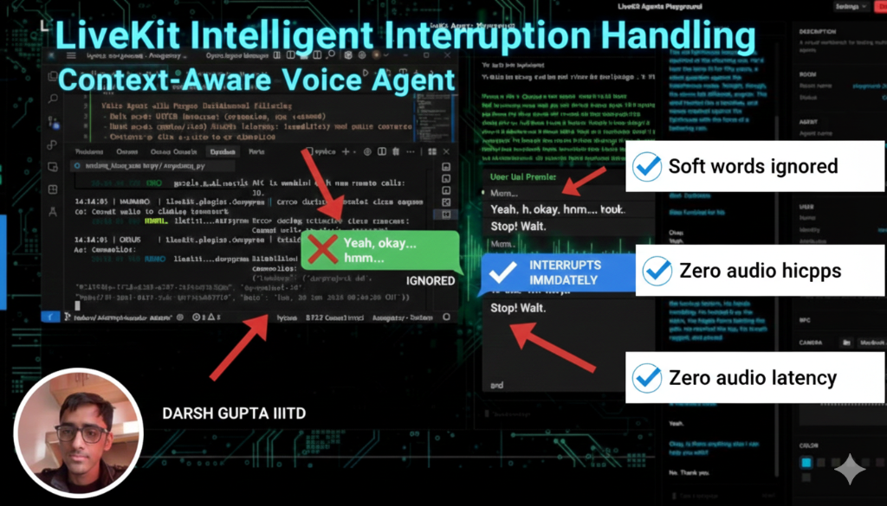

# Backchannel-Aware Voice Agent

A LiveKit voice agent that intelligently handles user interruptions by distinguishing between **backchannel words** (yeah, ok, hmm) and **real commands** (stop, wait, pause).

[](https://youtu.be/LPTMCm17Oo4)

**[Watch Demo Video](https://youtu.be/LPTMCm17Oo4)**

## Problem Solved

Normal voice agents stop when you say *anything* — even filler words like "yeah" or "ok". This breaks the natural flow of conversation.

**This agent:**
- Ignores soft words ("yeah", "ok", "hmm") while speaking
- Stops immediately on hard commands ("stop", "wait", "pause")
- Responds to soft words when silent (treats as valid input)
- Supports continue/resume after stopping
- Handles new questions with fresh context

---

## File Structure

```
examples/voice_agents/
├── backchannel_simple.py       # Main agent implementation
├── interruption_handler/
│   ├── __init__.py             # Exports InterruptionFilter
│   └── filter.py               # Word classification logic
├── demo_session_log.txt        # Sample session logs showing all scenarios
└── requirements.txt            # Dependencies
```

---

## How It Works

### 1. Speech Handle Wrapping (Core Mechanism)

When the agent starts speaking, we wrap `speech_handle.interrupt()`:

```python
def _wrap_speech_handle(self, handle):
    original_interrupt = handle.interrupt
    
    async def filtered_interrupt(**kwargs):
        if self.filter.should_ignore(self._last_user_text, is_agent_speaking=True):
            return  # BLOCK - agent continues speaking
        
        self._paused = True
        await original_interrupt(**kwargs)  # ALLOW - agent stops
    
    handle.interrupt = filtered_interrupt
```

**Key insight:** Interruptions are *prevented*, not undone. No resume_speech() or VAD hacks.

### 2. Word Classification

```python
# filter.py
soft_words = {"yeah", "ok", "okay", "hmm", "uh-huh", "right", "aha", ...}
hard_words = {"stop", "wait", "pause", "no", "hold", "but", ...}

def should_ignore(text, is_agent_speaking):
    if not is_agent_speaking:
        return False  # Always process when silent
    
    # Check for hard phrases first
    for phrase in hard_words:
        if phrase in text:
            return False  # Don't ignore - allow interrupt
    
    # Ignore only if ALL tokens are soft
    return all(token in soft_words for token in text.split())
```

### 3. State Management

| State | User Input | Action |
|-------|------------|--------|
| Speaking | Soft word | Ignore (continue) |
| Speaking | Hard word | Stop + Pause |
| Paused | Continue | Resume previous |
| Paused | New question | Clear context + Fresh response |
| Silent | Any input | Process normally |

---

## Quick Start

### Prerequisites
- Python 3.11+
- LiveKit Cloud account (or local server)
- Deepgram API key
- Google Gemini API key

### Setup

```bash
cd examples/voice_agents

# Create virtual environment
python -m venv venv
source venv/bin/activate

# Install dependencies
pip install -r requirements.txt

# Configure API keys
cp .env.example .env
# Edit .env with your keys:
# LIVEKIT_URL=wss://your-project.livekit.cloud
# LIVEKIT_API_KEY=...
# LIVEKIT_API_SECRET=...
# DEEPGRAM_API_KEY=...
# GOOGLE_API_KEY=...
```

### Run

```bash
# Development mode (auto-reload + playground)
python backchannel_simple.py dev

# Console mode (local testing)
python backchannel_simple.py console
```

Then open [agents-playground.livekit.io](https://agents-playground.livekit.io) and click Connect.

---

## Test Scenarios

| Test | User Action | Expected Result |
|------|-------------|-----------------|
| Soft word while speaking | Say "yeah" while agent talks | Agent continues seamlessly |
| Multiple soft words | Say "hmm ok yeah" | Agent continues |
| Hard word | Say "stop" | Agent stops immediately |
| Mixed input | Say "yeah but wait" | Agent stops ("but wait" = hard) |
| Continue after stop | Say "continue" | Agent resumes topic |
| New question after stop | Say "Tell me about X" | Fresh response (context cleared) |
| Soft word when silent | Say "yeah" to a question | Agent processes as answer |

---

## Configuration

### Modifying Word Lists

Edit `interruption_handler/filter.py`:

```python
soft_words = {
    "yeah", "ok", "okay", "hmm", "uh-huh", "right", "aha", "mhm",
    "sure", "gotcha", "yep", "yup", "mhmm", "alright", "cool", "nice"
}

hard_words = {
    "stop", "wait", "pause", "no", "hold", "hold on",
    "but wait", "hang on", "actually", "but", "however", "excuse me"
}
```

### VAD Settings

In `backchannel_simple.py`:

```python
vad=silero.VAD.load(
    min_speech_duration=0.3,    # Minimum speech to trigger
    min_silence_duration=0.6,   # Wait before end-of-turn
    activation_threshold=0.5    # Voice detection sensitivity
)
```

---

## Logs

The agent outputs detailed logs:

```
12:30:01 | INFO  | User: Yeah okay
12:30:01 | INFO  | Blocked interrupt for: Yeah okay
12:30:05 | INFO  | User: Stop
12:30:05 | INFO  | Allowing interrupt for: Stop
12:30:05 | WARN  | Hard interrupt: stop - entering paused state
12:30:08 | INFO  | User: Continue
12:30:08 | INFO  | CONTINUE detected - resuming paused content
```

---

## Key Design Decisions

1. **Prevention over Resumption**: We block interrupts before they happen, not after
2. **No VAD Modification**: All logic lives in the agent, not in speech detection
3. **Single Source of Truth**: `InterruptionFilter.should_ignore()` decides everything
4. **Context Isolation**: New questions after stop get fresh conversation context

