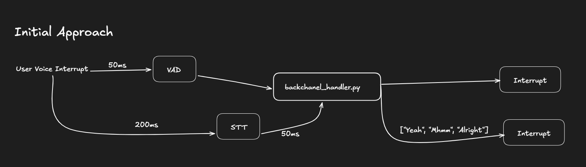
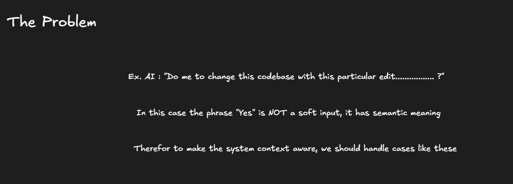
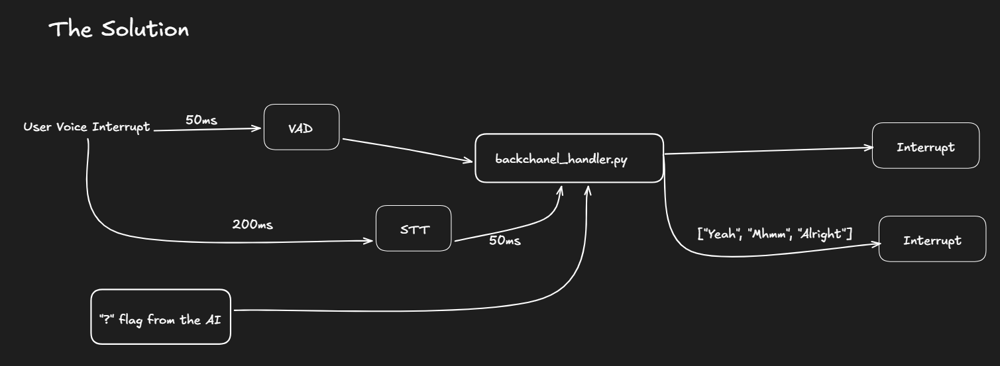

# Solution

# Video Solution : [Video Solution](https://youtu.be/fA2oHlr6i8Q)

# Intelligent Interruption Handler

The intelligent interruption handler distinguishes between passive acknowledgements (backchanneling) and active interruptions during agent speech.

## Core Logic

### 1. Backchanneling Detection
When the agent is speaking, certain words like "yeah", "ok", "hmm" are treated as passive acknowledgements and **do not interrupt** the agent.

### 2. Active Interruption Commands
Commands like "wait", "stop", "no", "actually" **always interrupt** the agent, even during speech.

### 3. Question Response Detection
When the agent's output contains a question mark (`?`), words like "yes", "yeah", "no" are treated as valid responses and **will interrupt** the agent to process the answer.

### 4. Context-Aware Behavior
- **Agent speaking + backchannel word**: No interrupt (backchanneling)
- **Agent speaking + interruption command**: Interrupt immediately
- **Agent speaking + question asked + response word**: Interrupt (valid response)
- **Agent silent**: All user input is treated as valid input

## Configuration

Enable with `ignore_backchanneling=True` in `AgentSession` options.

Customize word lists via `backchannel_words` and `interrupt_commands` parameters.